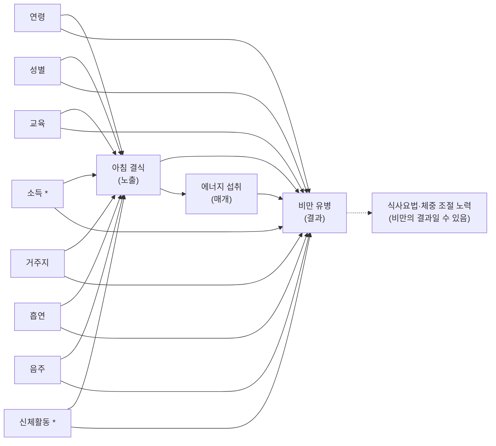

# 11주차 팀 과제 (9팀): DAG와 복합표본 회귀

<!--
작성 규칙: [ ] 와 [노트북 출력] 은 code/11_regression.ipynb 를 처음부터 실행한 출력으로 채운다. 숫자를 손으로 고치거나 추정해서 쓰지 않는다.
[확인] 은 팀이 이용지침서·정의표·선행연구를 직접 확인한 뒤 채우거나 지운다.
-->

- 자료: 국민건강영양조사 제9기(2022–2024) 중 2024년
- 노출: 아침 결식(이분형, 결식군 = `L_BR_FQ` 3·4, 비결식군 = 1·2)
- 결과: 비만 유병(BMI 25 kg/m² 이상, `HE_obe` 4~6)
- 분석 대상: 10주차와 같은 기준(만 19세 이상, 임신 제외, 아침식사 빈도·신장·체중·BMI 유효)

---

## C-1. DAG와 보정집합

### 1) DAG



- 실선은 원인에서 결과로 향하는 화살표이고, 점선은 보정하지 않는 변수를 가리킨다.
- `*` 소득·신체활동은 팀 DAG의 교란 후보이다. 10주차 노트북에서 읽은 변수 목록에는 없으므로 [확인: 정의표와 원자료에 있는지]. 원자료에 없거나 쓰지 않기로 하면 이 두 변수는 그림에서 "측정되지 않은 교란"으로 바꾸고 C-3 한계에 적는다.
- 체중 조절 노력이 비만의 결과일 수 있다는 가능성(결과 → 노출 방향의 역방향 인과)은 한 시점 자료에서 방향을 구별할 수 없고, 비순환 그래프에는 결과에서 노출로 돌아오는 화살표를 그릴 수 없다. 그래서 그림에는 점선으로만 표시하고 C-3 한계와 12주차 민감도분석으로 다룬다.
- 식사요법(`N_DIET`)이 체중 조절 노력과 같은 변수인지 [확인: 이용지침서 정의]. 다른 변수라면 체중 조절 문항을 정의표에 따로 넣어야 하고, 이 그림의 `diet` 노드는 `N_DIET`로만 해석한다.

### 2) dagitty.net 입력 (최소 보정집합 확인용)

```
dag {
  skip [exposure]
  obese [outcome]
  age -> skip
  age -> obese
  sex -> skip
  sex -> obese
  edu -> skip
  edu -> obese
  inc -> skip
  inc -> obese
  town -> skip
  town -> obese
  smk -> skip
  smk -> obese
  alc -> skip
  alc -> obese
  pa -> skip
  pa -> obese
  skip -> obese
  skip -> en
  en -> obese
  obese -> diet
}
```

- dagitty 결과(총효과의 최소 보정집합): [확인: dagitty 출력을 그대로 기록]
- 이 그림에서는 여덟 변수가 모두 노출과 결과의 직접 원인이므로 어느 것도 뺄 수 없을 것으로 예상된다. 공변량 사이에 화살표를 더하면 결과가 달라질 수 있으므로, 팀이 근거를 댈 수 있는 화살표만 추가하고 dagitty로 다시 확인한다.

### 3) 변수 역할 표

| 변수(코드) | 역할 | 화살표 근거(시간 순서, 선행연구) | 모형 2 |
|---|---|---|---|
| 연령(`age`) | 교란 | 연령은 노출·결과보다 먼저 정해지는 변수이다. [선행연구 확인 후 기재] | 포함 |
| 성별(`sex`) | 교란 | 성별은 출생 시 정해져 노출·결과보다 앞선다. [선행연구 확인 후 기재] | 포함 |
| 교육(`educ`, 4범주) | 교란 | 최종학력은 현재의 아침식사 습관과 체중 상태보다 앞서 형성된다고 본다. [선행연구 확인 후 기재] | 포함 |
| 소득 | 교란 | [확인: 변수와 근거] | [포함 / 변수 없음] |
| 거주지(`town_t`) | 교란 | [시간 순서와 선행연구 확인 후 기재] | 포함 |
| 흡연(`sm_presnt`) | 교란(역할이 애매할 수 있음) | 노출과 같은 시기의 생활습관이라 선후를 자료로 확인할 수 없다. 팀은 교란으로 보았다. [선행연구 확인 후 기재] | 포함 |
| 음주(`dr_month`) | 교란(역할이 애매할 수 있음) | 위와 같다. [선행연구 확인 후 기재] | 포함 |
| 신체활동 | 교란(역할이 애매할 수 있음) | 위와 같다. [확인: 변수와 근거] | [포함 / 변수 없음] |
| 에너지 섭취(`N_EN`) | 매개 | 아침을 거르면 하루 섭취량이 달라지고 섭취량이 체중에 영향을 줄 수 있어 노출의 결과이면서 결과의 원인이 될 수 있다고 본다. [선행연구 확인 후 기재] | **제외** |
| 식사요법(`N_DIET`) | 비만의 결과일 수 있음(역방향) | 체중 조절 노력은 비만에 대한 반응일 수 있다. [확인: 변수 정의] | **제외** |

### 4) 추정 대상과 보정집합

- 추정 대상: 아침 결식이 비만 유병에 미치는 **총효과**(한 시점 자료이므로 결과는 "관련성"으로 해석한다).
- 최소 보정집합: [dagitty 결과와 같게 기재: 연령, 성별, 교육, (소득), 거주지, 흡연, 음주, (신체활동)]
- 보정하지 않은 변수와 이유: 에너지 섭취는 매개변수이므로 총효과의 일부를 지우지 않으려고 제외하였다. 식사요법은 비만의 결과일 수 있어 보정하지 않았다.

### 5) 역할이 애매한 변수

- 흡연·음주·신체활동은 노출과 같은 시기의 생활습관이라 교란인지 매개인지 자료로 가릴 수 없다. 가장 그럴듯한 역할(교란)로 정했다.
- 12주차 민감도분석: 이 세 변수를 넣은 모형과 뺀 모형의 오즈비를 비교한다.
- 에너지 섭취는 매개로 보고 모형 2에서 뺐다. 필요하면 모형 3(모형 2 + 에너지 섭취)을 두어 오즈비가 얼마나 달라지는지 보되, 이 모형은 총효과가 아니라 에너지 섭취를 통하지 않는 관련성을 보는 용도로 읽는다. [모형 3을 둘지: 팀 결정]

---

## C-2. Table 2: 무보정·보정 회귀

노트북 6절 출력을 그대로 붙여 넣는다. 형식은 다음과 같다.

| 모형 | 분석 인원(n) | 결식군 vs 비결식군[기준] OR (95% CI) | p |
|---|---|---|---|
| 모형 1 (무보정) | [노트북 출력] | [노트북 출력] | [노트북 출력] |
| 모형 2 (DAG 보정집합) | [노트북 출력] | [노트북 출력] | [노트북 출력] |

- Table 1 분석 대상 [노트북 출력]명 대비 회귀 분석 인원 [노트북 출력]명 (보정변수 결측으로 [노트북 출력]명 제외). 결측 인원은 변수별로 교육 [ ]명, 흡연 [ ]명, 음주 [ ]명 등이다([노트북 출력]).
- 모형 1과 모형 2는 같은 사람(완전 사례)으로 적합하였다.

**각주**
- 설계: 가중치 `wt_tot`, 층 `kstrata`, 집락(층 안의 조사구 `psu`)을 반영한 설계 기반 로지스틱 회귀이다. 계수는 가중치로 추정하고 표준오차는 Taylor 선형화로 구하였다. 95% 신뢰구간과 p값은 설계 자유도 [노트북 출력]의 t분포를 사용하였다.
- 도메인: 설계 정보가 유효한 [노트북 출력]명의 행을 모두 유지하고, 분석에 쓰지 않는 사람의 가중치를 0으로 두었다.
- 모형: 모형 1은 노출만, 모형 2는 연령(연속, 1세 단위), 성별, 교육(4범주), [소득], 거주지, 흡연, 음주, [신체활동]을 보정하였다. OR는 비결식군 대비 결식군의 비만 오즈비이다.
- 결측: 보정변수가 모두 있는 사람만 분석하는 완전 사례 분석이며, 결측은 대체하지 않았다. 교육수준 99(모름·무응답)는 결측으로 처리하였다.
- 자료: 국민건강영양조사 제9기(2022–2024) 중 2024년.

---

## C-3. 결과 해석

**결과.** 비결식군에 비해 결식군의 비만 오즈비는 모형 1에서 [OR] (95% CI [하한]–[상한]), 모형 2에서 [OR] ([하한]–[상한])였다. 노출이 두 집단이므로 단위당 변화가 아니라 비결식군(기준) 대비 결식군의 비교이다.
- 모형 2의 95% 신뢰구간이 1을 포함하지 않으면: "결식군에서 비만 오즈가 [더 높은/더 낮은] 방향으로 관련되어 있었다."
- 1을 포함하면: "이 자료에서는 뚜렷한 관련성을 확인하지 못했다." ("관련이 없다"고 쓰지 않는다.)
- 비만 유병이 약 37%(Table 1 기준)로 흔한 결과이므로 오즈비는 위험이나 유병률의 비보다 1에서 더 멀게 나타난다. 오즈비를 "위험이 몇 배"로 읽지 않으며, 유병률비는 12주차에 다룬다.

**보정 전후.** 보정 후 오즈비는 [OR1]에서 [OR2]로 [증가/감소/거의 변화 없음](로그 오즈비 기준 [변화량])였다. 이 변화는 DAG에서 연령·성별·교육·거주지·생활습관이 노출과 결과의 공통 원인이라고 가정한 것과 [일치한다/일치하지 않는다]. [변화의 이유를 Table 1의 집단 간 분포 차이와 연결해 한두 문장으로 쓴다. 변화 방향은 결과를 본 뒤에 쓴다.]

**한계.**
- 한 시점 자료이므로 인과가 아닌 관련성만 말할 수 있다. 체중을 줄이려고 아침을 거르는 사람이 있다면 비만이 노출에 영향을 주는 역방향 인과가 생길 수 있다.
- 측정되지 않은 교란이 남아 있을 수 있다. [소득·신체활동을 보정하지 못했다면 여기에 명시한다.]
- 아침식사 빈도는 자기 보고 설문이라 응답 오차가 있을 수 있다.
- 완전 사례 분석으로 Table 1 대비 [노트북 출력]명이 제외되어, 제외된 사람의 특성이 다르면 결과가 달라질 수 있다.

**12주차 계획.**
1. 체중 조절 중인 사람을 뺀 민감도분석: 역방향 인과의 영향을 확인한다. [체중 조절 여부를 구별할 변수: 확인]
2. 역할이 애매한 변수(흡연·음주·신체활동)를 넣고 뺀 모형의 비교, 그리고 결측 처리 방법을 바꾼 분석과 유병률비 추정.

---

## 역할 분담

| 담당 | 내용 |
|---|---|
| [ ] | C-1 DAG와 역할 표 |
| [ ] | C-2 노트북과 Table 2 |
| [ ] | C-3 해석 |
| [ ] | 문서 정리·제출 |

## AI 사용 내역

<!-- 실제로 사용한 내용에 맞게 고쳐서 쓴다. -->
- [사용한 도구와 사용한 부분: 예) 회귀 함수 초안 작성 보조, 문서 구조 정리]
- 모든 숫자는 `code/11_regression.ipynb` 출력에서 가져왔고, 문헌과 이용지침서 내용은 팀이 직접 확인하였다. [실제와 다르면 수정]
