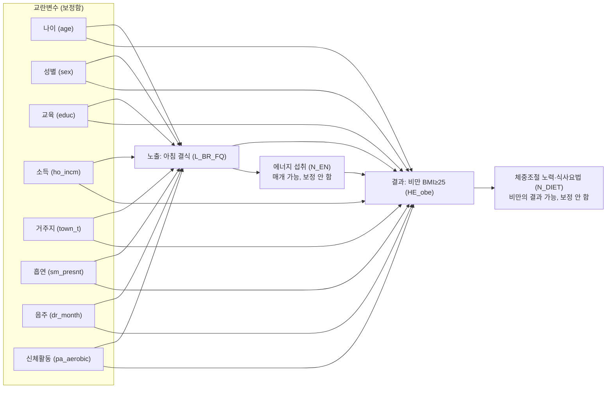

# 11주차 DAG와 복합표본 회귀 (9팀)

> 모든 숫자는 `code/11_regression.ipynb`의 출력에서 가져온다. 【】는 노트북을 처음부터 실행한 뒤 출력값으로 채우거나 팀이 직접 확인해서 적을 부분이다.

- 자료: 국민건강영양조사 제9기(2022-2024) 중 2024년 기본DB
- 연구질문: 우리나라 성인(만 19세 이상)에서 아침 결식(E)은 아침 식사를 하는 경우(C)에 비해 비만(BMI 25 이상, O) 유병과 연관되는가?
- 분석 대상과 변수 정의: 10주차와 같다. 최종 분석 대상 5,749명(결식군 1,686명, 비결식군 4,063명). 노트북 앞부분은 10주차 코드를 그대로 가져왔다.
- 10주차에서 달라진 점: 보정집합에 들어가는 **소득(`ho_incm`, 가구 소득 4분위)과 신체활동(`pa_aerobic`)**이 10주차 정의표와 Table 1에 없었다. 11주차 노트북은 이 두 변수를 더 읽었고(`[11주차 추가]` 표시), 10주차 정의표와 Table 1에도 같은 행을 추가해야 한다 【추가 후 확인】. 체중조절 노력(`BO2_1`)은 모형에 넣지 않고 12주차 민감도분석 준비용으로만 읽었다.

## C-1. DAG와 보정집합

### 추정 대상

**총효과**(아침 결식이 비만 유병과 연관되는 전체 크기)를 본다. 한 시점 자료이므로 결과는 '관련성'으로 해석한다.

### DAG

실선은 원인에서 결과로 향하는 화살표이다. 교란 후보는 모두 노출과 결과의 공통 원인으로 보았다.



그림에서 생략한 것: 교란 후보 사이의 화살표(예: 교육 → 소득, 나이·성별 → 생활습관)는 모두 노출과 결과의 공통 원인이라서 보정집합을 바꾸지 않으므로 생략했다.

### 화살표와 근거

| 화살표 | 근거 (한 줄) | 근거 종류 | 확신 |
|---|---|---|---|
| 아침 결식 → 비만 | 아침을 거르면 이후 끼니의 과식·간식 증가, 식사의 질 저하, 식사 시간 불규칙이 체중에 영향을 줄 수 있다. 횡단 연구 메타분석은 결식군의 과체중·비만 OR 1.48(1.40–1.57)이었고(Ma 2020), 종단 연구는 주 3일 이상 결식에서 RR 1.13(1.06–1.21)으로 근거 수준이 낮았다(Wicherski 2021). 무작위 시험은 결식이 오히려 체중을 약 0.5 kg 줄였다(Bonnet 2020). | 가설, 선행연구(엇갈림) | 약 |
| 아침 결식 → 에너지 섭취 | 결식은 24시간 식사 구성을 바꾸고, 아침 식사 자체가 총에너지 섭취에 포함된다. | 시간 순서, 가설 | 중 |
| 에너지 섭취 → 비만 | 에너지 섭취는 체중 변화의 직접 경로이다. | 선행연구(에너지 균형) | 중 |
| 비만 → 체중조절 노력·식사요법 | 체중 상태가 체중 조절 시도의 동기가 된다. `N_DIET`는 질환이나 체중 조절 때문에 식사를 조절하는지 묻는 문항이다(이용지침서 232쪽). | 시간 순서, 변수 정의 | 중 |
| 나이 → 결식 | 젊은 성인에서 결식이 더 흔하다. 10주차 Table 1에서도 결식군의 평균 나이가 낮았다(39.4세 대 55.4세). KNHANES 결식 연구들이 나이를 공변량으로 다룬다(PMC7714101, PMC7788749). | 시간 순서, 선행연구 | 강 |
| 나이 → 비만 | 나이는 비만 유병에 앞서며, 연령에 따라 유병률이 다르다. | 시간 순서 | 강 |
| 성별 → 결식 | 성별은 타고나며 결식 양상이 성별에 따라 다르다고 보고된다. 단, 방향은 선행연구 원문에서 확인한다. | 시간 순서, 선행연구 【확인】 | 중 |
| 성별 → 비만 | 성별은 타고나며 비만 유병률이 성별에 따라 다르다. | 시간 순서 | 강 |
| 교육 → 결식 | 학력은 성인기 식습관(결식 포함)에 앞선다. 교육을 공변량으로 쓴 KNHANES 결식 연구가 있다(PMC7788749). | 시간 순서, 선행연구 | 중 |
| 교육 → 비만 | 학력은 성인기 체중에 앞서며 건강 인식과 식생활에 영향을 준다. | 시간 순서 | 중 |
| 소득 → 결식 | 가구 소득은 식사 준비·식품 접근성에 영향을 줄 수 있다. 가구소득을 공변량으로 쓴 KNHANES 결식 연구가 있다(PMC7788749). | 선행연구 | 중 |
| 소득 → 비만 | 가구 소득은 식품 선택과 신체활동 기회에 영향을 준다. | 선행연구 【확인】 | 중 |
| 거주지 → 결식 | 동·읍면에 따라 식품 접근성과 생활 방식이 다르다. | 가설 | 약 |
| 거주지 → 비만 | 거주지는 성인기 체중에 앞서며 생활환경이 다르다. | 시간 순서 | 중 |
| 흡연 → 결식 | 흡연자는 불규칙한 식습관을 가진 경향이 있다. KNHANES 결식 연구가 흡연을 공변량으로 다룬다(PMC7788749). 10주차 Table 1에서도 결식군의 현재흡연이 많았다(21.5% 대 12.6%). | 선행연구 | 중 |
| 흡연 → 비만 | 흡연은 체중에 영향을 준다. | 선행연구 【확인】 | 중 |
| 음주 → 결식 | 전날 음주가 다음 날 아침 식욕과 식사에 영향을 줄 수 있다. 10주차 Table 1에서도 결식군의 월 1회 이상 음주가 많았다(65.3% 대 51.2%). | 가설 | 약 |
| 음주 → 비만 | 알코올은 에너지 섭취에 기여한다. | 선행연구 【확인】 | 중 |
| 신체활동 → 결식 | 활동량이 식사 습관과 함께 생활 방식을 이룬다. 단, 결식이 피로를 일으켜 활동량을 줄이는 반대 방향도 가능하다(아래 애매한 변수). | 가설 | 약 |
| 신체활동 → 비만 | 활동량은 에너지 소비에 직접 영향을 준다. | 선행연구(에너지 균형) | 중 |

선행연구 칸의 문헌은 검색으로 초록·요약만 확인했다. 제출 전에 팀이 원문에서 결과 방향을 확인한다 【】.

### 공변량 역할 표

| 공변량 (정의표 변수) | 역할 | 보정 | 근거 |
|---|---|---|---|
| 나이 (`age`) | 교란 | 한다 | 노출과 결과 모두에 앞서는 공통 원인 |
| 성별 (`sex`) | 교란 | 한다 | 노출과 결과 모두에 앞서는 공통 원인 |
| 교육 (`educ`) | 교란 | 한다 | 성인기 식습관·체중에 앞서는 공통 원인 |
| 소득 (`ho_incm`) | 교란 | 한다 | 식품 접근성·식습관·체중의 공통 원인 |
| 거주지 (`town_t`) | 교란 | 한다 | 생활환경이 식습관·체중의 공통 원인 |
| 흡연 (`sm_presnt`) | 교란 (애매) | 한다 | 생활습관이 결식과 체중에 모두 연결된다고 봄 |
| 음주 (`dr_month`) | 교란 (애매) | 한다 | 생활습관이 결식과 체중에 모두 연결된다고 봄 |
| 신체활동 (`pa_aerobic`) | 교란 (애매) | 한다 | 활동량이 식습관·체중의 공통 원인이라고 봄. 매개일 가능성은 12주차에 확인 |
| 에너지 섭취 (`N_EN`) | 매개 | 하지 않는다 | 결식의 결과이면서 비만의 원인. 보정하면 총효과의 일부를 지운다 |
| 체중조절 노력·식사요법 (`N_DIET`) | 비만의 결과 (역방향 경로) | 하지 않는다 | 비만 때문에 생기는 행동. 결과의 결과를 보정하면 편향이 생길 수 있다 |

### 보정집합

- 총효과를 보므로 **교란변수만 보정**한다.
- 최소 보정집합: **{나이, 성별, 교육, 소득, 거주지, 흡연, 음주, 신체활동}**. 8개 모두 노출과 결과에 직접 화살표를 보내므로(공통 원인) 하나도 뺄 수 없다.
- 매개변수(에너지 섭취)와 비만의 결과(체중조절 노력·식사요법)는 보정하지 않는다.
- dagitty.net 확인용 입력 (노출 `E`, 결과 `O`로 표시):

```
dag {
E [exposure]
O [outcome]
Age -> E
Age -> O
Sex -> E
Sex -> O
Edu -> E
Edu -> O
Inc -> E
Inc -> O
Res -> E
Res -> O
Smk -> E
Smk -> O
Drk -> E
Drk -> O
PA -> E
PA -> O
E -> O
E -> EnergyIntake
EnergyIntake -> O
O -> WtControl
}
```

- dagitty.net 결과: 【입력 후 "Causal effect identification"의 Minimal sufficient adjustment sets 결과(또는 캡처)를 붙여 넣는다. 위 8개가 나와야 한다】

### 애매한 변수

| 변수 | 어떻게 정했나 | 12주차 확인 |
|---|---|---|
| 체중조절 노력·식사요법 (`N_DIET`) | 체중을 줄이려고 아침을 거르는 사람이 있다면 비만이 결식의 원인이 된다(역방향). 동시에 비만이어서 체중 조절을 시도하기도 한다. 두 방향을 한 DAG에 함께 그리면 결식 → 비만 → 체중조절 → 결식의 순환이 생겨 한 시점 자료로는 풀 수 없다. 시간 순서상 가장 그럴듯한 '비만의 결과'로 정하고 보정하지 않는다. | 체중 조절 중인 사람을 뺀 민감도분석 (C-3) |
| 신체활동 (`pa_aerobic`) | 활동량이 식습관과 체중의 공통 원인이라고 보아 교란으로 정했다. 결식이 피로를 일으켜 활동량을 줄이는 경로(매개)도 가능하다. | 신체활동을 뺀 모형과 비교 (C-3) |
| 흡연·음주 | 생활습관 군집으로 교란이라고 보았다. 결식이 흡연·음주를 바꾼다고 보기는 어렵지만 방향은 자료로 확인할 수 없다. | 신체활동과 함께 생활습관 변수를 뺀 모형 비교 |
| 에너지 섭취 (`N_EN`) | 결식의 결과이면서 비만의 원인이라 매개로 정했다. 24시간 회상 1일치라 측정 오차도 크다. | 직접효과를 보려면 모형 2에 추가한 모형 (필요하면) |

## C-2. Table 2 — 무보정·보정 회귀

### 분석 인원

| 구분 | 인원 |
|---|---|
| Table 1 분석 대상 (`in_study = 1`) | 5,749 |
| 보정변수가 모두 있는 사람 (`complete_case = 1`) = 모형 1·2의 분석 인원 | 【노트북】 |
| 차이 (보정변수 결측으로 빠짐) | 【노트북】 |

보정변수별 결측 인원 (분석 대상 안): 교육 【】, 가구소득 【】, 현재흡연 【】, 월간음주 【】, 신체활동 【】, 나이·성별·거주지 0명 【노트북 "보정변수별 결측 인원" 출력】. 완전 사례로 남은 사람과 빠진 사람의 결식 비율과 비만 비율(비가중): 【노트북 출력】.

### Table 2

**표 2. 아침 결식과 비만(BMI 25 이상) 유병의 관련성: 설계 기반 로지스틱 회귀**

| 모형 | 노출 | OR | 95% CI | p | 분석 인원 | Table 1 대비 차이 |
|---|---|---|---|---|---|---|
| 모형 1 (무보정) | 결식군 (기준: 비결식군) | 【】 | 【】 | 【】 | 【】 | 【】 |
| 모형 2 (보정) | 결식군 (기준: 비결식군) | 【】 | 【】 | 【】 | 【】 | 【】 |

【노트북 "md에 붙여 넣을 형식" 출력으로 위 표를 교체한다】

각주

a. 모든 모형은 가중치 `wt_tot`, 층 `kstrata`, 집락 `psu`(층+조사구)를 반영한 설계 기반 추정이다. 분석 대상 밖(보정변수 결측 포함)은 행을 지우지 않고 가중치를 0으로 두는 도메인 방식으로 처리했다.

b. 로지스틱 회귀(결과: 비만, BMI 25 이상 = 1). 회귀계수는 가중 의사우도로 추정했고, 분산은 층·집락을 반영한 Taylor 선형화(sandwich) 추정이다. 95% 신뢰구간과 p 값은 자유도(집락 수 − 층 수 = 【노트북 출력】)를 쓴 t 분포 기준이다. OR은 결식군 대 비결식군(기준)이다.

c. 모형 2의 보정변수: 나이(10세 단위, 50세 중심, 제곱항 포함), 성별, 교육(초등학교 이하 / 중학교 / 고등학교 / 대학 이상 4범주), 가구소득(4분위), 거주지(동 / 읍·면), 현재흡연, 월간음주, 유산소 신체활동. 에너지 섭취(매개 가능)와 식사요법·체중조절 노력(비만의 결과 가능)은 넣지 않았다.

d. 결측 처리: 모형 1과 모형 2를 같은 사람(보정변수가 모두 있는 완전 사례)으로 적합했다. `educ` 88·99는 결측으로 처리했다. 결측값을 채우거나 대체하지 않았다.

e. 자료: 질병관리청 국민건강영양조사 제9기(2022-2024) 중 2024년.

## C-3. 결과 해석

### 결과

- 【보정 후(모형 2)의 값으로 쓴다. 예: "다른 조건이 같을 때 결식군은 비결식군보다 비만(BMI 25 이상) 유병의 오즈가 OR ○(95% CI ○–○)배였다." 신뢰구간이 1을 포함하면 "이 자료에서는 뚜렷한 관련성을 확인하지 못했다"고 쓰고 "관련이 없다"고 쓰지 않는다】
- 오즈비 해석 주의: 비만 유병이 37% 안팎으로 흔하므로 오즈비는 유병률비보다 1에서 멀어 보여 위험의 차이를 실제보다 크게 보여 준다. 완전 사례의 가중 비만 유병률은 결식군 【】%, 비결식군 【】%이다 【노트북 "참고" 출력】. 유병률비는 12주차에 구한다.
- 선행연구와 비교: 횡단 연구 메타분석의 OR 1.48(Ma 2020), 종단 연구의 RR 1.13(Wicherski 2021)과 이 결과의 크기를 비교한다 【】. 횡단 연구가 더 크게 나오는 것은 역방향 인과나 측정되지 않은 교란과 맞는 결과일 수 있다.

### 보정 전후

- 무보정 OR 【】 → 보정 OR 【】 (【커졌다/작아졌다】, 로그 OR 기준 【】).
- DAG와 연결: 모형 2의 보정변수는 모두 결식과 비만의 공통 원인이다. 그 가운데 나이는 10주차 Table 1에서 결식군이 훨씬 젊었고(39.4세 대 55.4세), 나이가 많을수록 비만 유병이 높다면 무보정 OR은 결식의 효과를 실제보다 작게 보이게 하는 방향으로 치우치고, 나이를 보정하면 커진다. 【이 문장은 실제 변화가 이 방향일 때만 쓴다. 반대 방향이면 어떤 변수가 그렇게 만들었는지 노트북의 보정변수 OR을 보고 DAG 근거와 연결해 다시 쓴다】
- 에너지 섭취는 매개로 보아 넣지 않았으므로, 모형 2는 결식이 에너지 섭취를 거쳐 만드는 경로까지 포함한 총효과를 본다.

### 한계

- 한 시점 자료이므로 '관련성'이며 인과가 아니다.
- 역방향 인과: 체중을 줄이려고 아침을 거르는 사람은 이미 비만이거나 체중이 늘었을 수 있다. 체중조절 노력은 비만의 결과일 수 있어 보정하지 않았고, 아래 민감도분석으로 확인한다.
- 측정되지 않은 교란: 식사의 질, 수면, 근무 형태, 스트레스 등은 이 분석에 없다.
- 자기기입 자료의 오차: 아침식사 빈도는 최근 1년 동안의 응답이며(이용지침서 218쪽), 노출 분류(주 1~2회 이하를 결식)에 따라 결과가 달라질 수 있다. 에너지 섭취는 24시간 회상 1일치이다.
- 완전 사례 분석: 보정변수 결측 때문에 Table 1 대상(5,749명)보다 【】명 적다. 결측이 무작위가 아니면 결과가 치우칠 수 있다.
- BMI 25 이상은 이분 기준이라 BMI의 연속적 차이를 보지 못한다.

### 12주차 계획

1. **체중 조절 중인 사람을 뺀 민감도분석** (역방향 인과 확인): 최근 1년간 체중을 줄이려고 노력한 사람(`BO2_1` = 1, 이용지침서 140쪽)을 뺀 완전 사례로 모형 2를 다시 적합하고 OR을 비교한다. 규모는 완전 사례 중 체중 감소 노력자 【노트북 출력】명이다. 필요하면 체중 유지·증가 노력자(`BO2_1` 2·3)와 `N_DIET`가 '예'인 사람까지 빼는 변형도 본다. 체중 조절 중인 사람을 빼도 OR이 비슷하면 역방향 인과의 영향이 작다는 쪽이지만, 확정할 수는 없다.
2. **신체활동을 뺀 모형과 비교** (매개 가능성 확인): 모형 2에서 신체활동을 뺀 모형의 OR이 얼마나 달라지는지 본다. 이와 함께 오즈비 대신 유병률비를 구하는 모형을 12주차에 다룬다.

## 역할 분담

| 담당자 | 맡은 부분 |
|---|---|
| 【】 | C-1 DAG와 역할 표, dagitty.net 확인 |
| 【】 | C-2 Table 2와 각주 |
| 【】 | C-3 결과 해석 |
| 【】 | 노트북 처음부터 실행, 숫자 대조, 개인별 행 출력 여부 확인 |
| 【】 | 10주차 정의표·Table 1 수정 (소득·신체활동 추가) |

## AI 사용 내역

- Claude (Anthropic): 【팀이 실제로 한 것만 적는다. 예: DAG 초안, 노트북 코드 초안, 문서 뼈대 작성 보조. Claude는 원시자료를 볼 수 없었고 코드를 직접 실행하지 않았다. 코드는 팀원이 Colab에서 처음부터 실행했고 문서의 모든 숫자는 그 출력값이다. 변수의 역할과 보정집합은 팀이 직접 정했다】

## 참고문헌

- Ma X, et al. Skipping breakfast is associated with overweight and obesity: a systematic review and meta-analysis. Obes Res Clin Pract. 2020;14(1):1-8. doi:10.1016/j.orcp.2019.12.002
- Wicherski J, Schlesinger S, Fischer F. Association between breakfast skipping and body weight: a systematic review and meta-analysis of observational longitudinal studies. Nutrients. 2021;13(1):272. doi:10.3390/nu13010272
- Bonnet JP, et al. Breakfast skipping, body composition, and cardiometabolic risk: a systematic review and meta-analysis of randomized trials. Obesity. 2020. doi:10.1002/oby.22791
- KNHANES 결식 요인·공변량 연구: PMC7788749, PMC7714101 【원문 확인 후 서지 정보로 교체】
- 질병관리청. 국민건강영양조사 제9기(2022-2024) 원시자료 이용지침서 (소득 93쪽, 체중조절 140쪽, 신체활동 169쪽, 식사요법 232쪽, 아침식사 빈도 218쪽)
