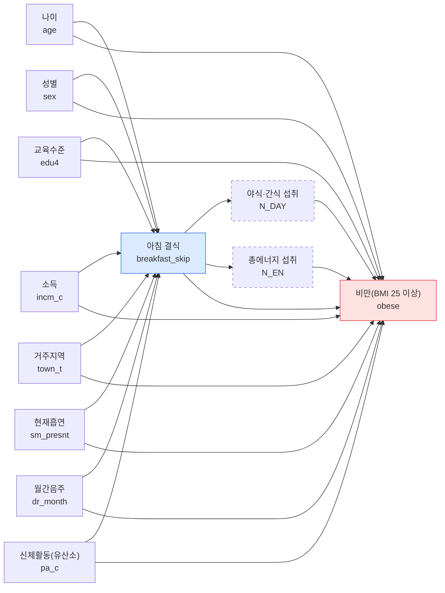

# 11주차 팀 과제 (9팀): DAG와 복합표본 회귀

> **제출 전 지울 것** (이 박스 전체)
> - `[ ]`로 표시한 곳은 `code/11_regression.ipynb`를 실행한 출력으로 채운다. 숫자는 출력에서만 가져온다.
> - 가중치는 10주차와 같은 `wt_tot`이다. 정의표에는 `wt_itvex`로 적혀 있으니 팀이 하나로 확정하고, 바꾸면 10주차 파일도 함께 고친다.
> - DAG의 교란변수 중 교육·소득·거주지·흡연·음주가 정의표(공변량 표)에 없으면 정의표에 행을 추가한다.
> - dagitty.net 결과, 선행연구 인용, 역할 분담, AI 사용 내역은 팀이 직접 채운다.

자료: 국민건강영양조사 제9기(2022-2024) 중 2024년. 노출은 아침 결식, 결과는 비만(BMI 25 이상)이다. 분석 대상과 변수 정의는 10주차와 같다.

## C-1. DAG와 보정집합

### 그림



점선 테두리는 매개 후보이다. 체중 조절 노력은 비만의 결과일 수 있고(역방향) 정의표에 없는 변수라 그림에 넣지 않고 C-3 한계에 적었다.

### 역할 표

| 변수 | 변수명 | 역할 | 보정 | 근거(시간 순서) | 선행연구 |
|:--|:--|:--|:--|:--|:--|
| 나이 | `age` | 교란 | O | 나이는 식습관과 체중보다 먼저 정해진다 | (인용 추가) |
| 성별 | `sex` | 교란 | O | 성별은 태어날 때 정해지며 식습관과 체중에 모두 영향을 준다 | (인용 추가) |
| 교육수준 | `edu4` | 교란 | O | 교육은 성인기 식습관과 체중 상태보다 먼저 이루어진다 | (인용 추가) |
| 소득 | `incm_c` | 교란 | O | 소득은 식사 여건과 식품 선택을 통해 식습관과 체중에 영향을 준다 | (인용 추가) |
| 거주지역 | `town_t` | 교란 | O | 거주지는 식품 접근성·생활 환경을 통해 식습관과 체중에 영향을 준다 | (인용 추가) |
| 현재흡연 | `sm_presnt` | 교란 | O | 흡연은 식욕·생활 리듬과 관련된다 (한 시점 자료라 시간 순서 불확실) | (인용 추가) |
| 월간음주 | `dr_month` | 교란 | O | 음주는 다음 날 식사와 섭취 열량에 영향을 줄 수 있다 (시간 순서 불확실) | (인용 추가) |
| 신체활동(유산소) | `pa_c` | 교란 | O | 정의표: 식습관과 체중 모두에 영향을 주는 공통 원인으로 간주 (애매한 변수, 아래 참고) | (인용 추가) |
| 야식·간식 섭취 | `N_DAY` | 매개 | X | 아침 결식 후 허기로 야식·간식이 늘고, 이것이 섭취 열량을 통해 체중에 영향을 준다 (정의표) | (인용 추가) |
| 총에너지 섭취 | `N_EN` | 매개 | X | 아침 결식 후 총 섭취 열량이 달라지고, 이것이 체중에 영향을 준다 (정의표) | (인용 추가) |

충돌부로 본 변수는 없다.

### 화살표별 근거

| 화살표 | 근거(시간 순서) | 선행연구 |
|:--|:--|:--|
| 나이 → 아침 결식 | 나이는 식습관보다 먼저 정해지며 연령대마다 아침 식사 습관이 다르다 | (인용 추가) |
| 나이 → 비만(BMI 25 이상) | 나이는 체중 상태보다 먼저 정해지며 연령에 따라 비만 비율이 다르다 | (인용 추가) |
| 성별 → 아침 결식 | 성별은 태어날 때 정해지며 식사 습관이 성별로 다를 수 있다 | (인용 추가) |
| 성별 → 비만(BMI 25 이상) | 성별은 태어날 때 정해지며 체지방과 비만 비율이 성별로 다르다 | (인용 추가) |
| 교육수준 → 아침 결식 | 교육은 성인기 식습관 형성보다 먼저 이루어지며 식사 시간·선택에 영향을 줄 수 있다 | (인용 추가) |
| 교육수준 → 비만(BMI 25 이상) | 교육은 체중 상태보다 먼저 이루어지며 건강 지식과 생활 습관에 영향을 줄 수 있다 | (인용 추가) |
| 소득 → 아침 결식 | 소득은 식사에 쓸 시간과 비용 등 식사 여건에 영향을 줄 수 있다 | (인용 추가) |
| 소득 → 비만(BMI 25 이상) | 소득은 식품 선택과 생활 환경을 통해 체중에 영향을 줄 수 있다 | (인용 추가) |
| 거주지역 → 아침 결식 | 거주지(동/읍·면)는 식품 접근성과 생활 리듬에 영향을 줄 수 있다 | (인용 추가) |
| 거주지역 → 비만(BMI 25 이상) | 거주지는 식품·운동 환경을 통해 체중에 영향을 줄 수 있다 | (인용 추가) |
| 현재흡연 → 아침 결식 | 흡연은 식욕과 생활 리듬에 영향을 줄 수 있다 (한 시점 자료라 시간 순서는 불확실) | (인용 추가) |
| 현재흡연 → 비만(BMI 25 이상) | 흡연은 식욕과 대사를 통해 체중에 영향을 줄 수 있다 (시간 순서는 불확실) | (인용 추가) |
| 월간음주 → 아침 결식 | 음주는 다음 날 아침 식사에 영향을 줄 수 있다 (시간 순서는 불확실) | (인용 추가) |
| 월간음주 → 비만(BMI 25 이상) | 음주는 섭취 열량을 통해 체중에 영향을 줄 수 있다 | (인용 추가) |
| 신체활동(유산소) → 아침 결식 | 신체활동은 식습관과 함께 형성되는 생활 습관이다 (정의표: 식습관·체중 모두에 영향을 주는 공통 원인) | (인용 추가) |
| 신체활동(유산소) → 비만(BMI 25 이상) | 신체활동은 에너지 소비를 통해 체중에 영향을 준다 | (인용 추가) |
| 아침 결식 → 야식·간식 섭취 | 아침 결식 이후 허기로 야식·간식이 늘 수 있다 (정의표: 매개 후보) | (인용 추가) |
| 야식·간식 섭취 → 비만(BMI 25 이상) | 야식·간식은 섭취 열량을 늘려 체중에 영향을 준다 | (인용 추가) |
| 아침 결식 → 총에너지 섭취 | 아침 결식 이후 하루 총 섭취 열량이 달라질 수 있다 (정의표: 매개 후보) | (인용 추가) |
| 총에너지 섭취 → 비만(BMI 25 이상) | 섭취 열량은 체중에 영향을 준다 | (인용 추가) |
| 아침 결식 → 비만(BMI 25 이상) | 추정 대상: 아침 결식이 비만에 미치는 총효과 | (인용 추가) |

### 보정집합

- **추정 대상: 총효과** (아침 결식이 비만에 미치는 전체 효과).
- **최소 보정집합: 나이, 성별, 교육수준, 소득, 거주지역, 현재흡연, 월간음주, 신체활동(유산소)** (교란변수 8개). 매개 후보인 야식·간식 섭취와 총에너지 섭취는 총효과의 일부를 지우므로 보정하지 않았다.
- 노트북(부록 A)에서 후문 기준으로 이 집합이 모든 후문 경로를 막고, 하나라도 빼면 막지 못함을 확인했다.
- dagitty.net 결과: [dagitty.net에 아래 입력을 붙여 나온 adjustment set을 적는다]

```
dag {
  skip [exposure]
  obese [outcome]
  age -> skip
  age -> obese
  sex -> skip
  sex -> obese
  educ -> skip
  educ -> obese
  incm -> skip
  incm -> obese
  area -> skip
  area -> obese
  smoke -> skip
  smoke -> obese
  drink -> skip
  drink -> obese
  pa -> skip
  pa -> obese
  skip -> nday
  nday -> obese
  skip -> nen
  nen -> obese
  skip -> obese
}
```

### 애매한 변수

- **신체활동(`pa_aerobic`)**: 정의표에 따라 식습관과 체중 모두에 영향을 주는 공통 원인(교란)으로 보고 모형 2에서 보정했다.
- 다만 아침 결식이 피로감과 에너지 부족을 일으켜 신체활동을 줄이고 그것이 체중에 영향을 주는 경로(매개)를 완전히 배제할 수 없다. 한 시점 자료라 방향을 자료로 가를 수 없다.
- **12주차 확인 방법:** 신체활동을 뺀 모형과 넣은 모형의 오즈비를 비교하는 민감도분석을 한다(이번 주 모형 3이 예비 확인).
- 흡연과 음주도 시간 순서가 불확실해 12주차에 넣고 빼는 비교로 확인한다. 매개 후보(야식·간식, 총에너지)를 추가한 직접효과 모형도 12주차에 본다.

## C-2. Table 2: 무보정·보정 회귀

**Table 2.** 아침 결식과 비만(BMI 25 이상)의 관련성: 복합표본 로지스틱 회귀, 오즈비(95% 신뢰구간)

| 노출 | 모형 1 OR | 95% CI | p | 모형 2 OR | 95% CI | p | 모형 3 OR | 95% CI | p |
|:--|--:|:--|--:|--:|:--|--:|--:|:--|--:|
| 아침 식사 (기준) | 1.00 | | | 1.00 | | | 1.00 | | |
| 아침 결식 | 1.11 | 0.98–1.26 | 0.091 | 1.16 | 0.99–1.35 | 0.058 | 1.17 | 1.01–1.36 | 0.040 |
| 분석 인원 n | 5,272 | | | 5,272 | | | 5,272 | | |
| Table 1 대비 제외 n | 477 | | | 477 | | | 477 | | |
| 보정변수 | 없음 | | | 8개 | | | 7개(신체활동 제외) | | |

**각주.** (노트북 5절의 각주 출력을 붙인다. 아래는 형식이다.)
OR = 오즈비, CI = 신뢰구간. 기준 범주는 아침 식사이며, 아침 결식은 10주차 정의(L_BR_FQ 3·4)를 따랐다. 가중치 `wt_tot`, 층 `kstrata`, 집락 `psu`(층+조사구)를 적용한 복합표본 로지스틱 회귀이며, 표준오차는 Taylor 선형화로 추정하고 95% 신뢰구간과 p값은 자유도 [ ](집락 수 − 층 수)의 t분포로 구하였다. 분석 대상(Table 1의 5,749명)은 자료를 삭제하지 않고 도메인으로 지정하였다. 결과는 비만(BMI 25 이상, HE_obe 4~6)이다. 모형 1은 무보정, 모형 2는 DAG로 정한 총효과 보정집합(나이, 성별, 교육수준, 소득, 거주지역, 현재흡연, 월간음주, 신체활동(유산소)), 모형 3은 모형 2에서 신체활동만 뺀 모형이다. 에너지 섭취와 야식·간식은 매개 후보라, 체중 조절 노력은 역방향 가능성이 있어 보정하지 않았다. 보정변수가 모두 있는 5,272명(완전 사례)으로 세 모형을 같은 사람에게 적합하였으며 Table 1 분석 대상보다 477명 적다(보정변수 결측, 결측 값은 대체하지 않음). 비만 유병률이 높아([ ]%) 오즈비가 위험을 실제보다 크게 보일 수 있다(유병률비는 12주차). 자료: 국민건강영양조사 제9기(2022-2024) 중 2024년.

## C-3. 결과 해석

- **결과:** 보정 후(모형 2), 아침 결식군은 아침 식사군보다 비만일 오즈가 1.16배(95% CI 0.99–1.35, p = 0.058)였다. 신뢰구간이 1을 포함하므로 이 자료에서는 뚜렷한 관련성을 확인하지 못했다(점추정은 결식군의 오즈가 높은 방향). 관련성으로 해석하고 인과로 쓰지 않는다.
- **보정 전후:** 오즈비가 무보정 1.11(95% CI 0.98–1.26)에서 보정 후 1.16(0.99–1.35)로 변해 1에서 멀어졌다(변화율은 노트북 부록 B 출력의 값을 적는다). 이는 C-1의 DAG에서 교란으로 본 변수들(나이, 성별, 교육수준, 소득, 거주지역, 현재흡연, 월간음주, 신체활동(유산소))이 아침 결식과 비만 모두의 공통 원인이기 때문일 수 있다. 신체활동을 뺀 모형 3의 오즈비는 1.17(95% CI 1.01–1.36)로 모형 2와 거의 같다. 신뢰구간 하한이 1을 넘었지만 모형 2와 사실상 같은 크기이므로 모형 3을 근거로 결론을 바꾸지 않고 12주차 민감도분석에서 확인한다.
- **한계:**
  - 한 시점 자료라 시간 순서를 알 수 없고, 비만이 식습관 변화(체중 조절 노력 등)의 원인일 수 있는 역방향 인과를 배제할 수 없다.
  - 체중 조절 노력 등 측정되지 않은 교란이 남아 있을 수 있다.
  - 아침 식사 빈도는 자기 기입 자료라 분류 오차가 있을 수 있다.
  - 보정변수가 모두 있는 사람만 분석해 477명이 빠졌으며, 결측이 무작위가 아니면 결과가 달라질 수 있다.
  - 비만 유병률이 높아 오즈비가 위험을 실제보다 크게 보일 수 있다.
- **12주차 계획:**
  - 신체활동·흡연·음주를 넣고 빼는 비교(역할이 애매한 변수)와 매개 후보를 추가한 직접효과 모형.
  - 체중 조절 중인 사람을 뺀 분석(역방향 인과 확인), 결측 처리 방법 바꾸기, 유병률비 산출.

## 역할 분담

| 이름 | 담당 |
|:--|:--|
| [ ] | DAG와 역할 표 (C-1) |
| [ ] | 노트북 실행과 Table 2 (C-2) |
| [ ] | 결과 해석 (C-3) |
| [ ] | 10주차 Issue 수정, 최종 점검과 커밋 |

## AI 사용 내역

| 사용 도구 | 사용한 곳 | 팀이 확인한 내용 |
|:--|:--|:--|
| Claude | 노트북 구조와 복합표본 회귀 함수 초안, DAG 코드, 문서 초안 | [팀이 직접 확인한 내용: 예) 정의표와 변수명 대조, 노트북 전체 실행, 숫자가 출력과 같은지 확인] |
