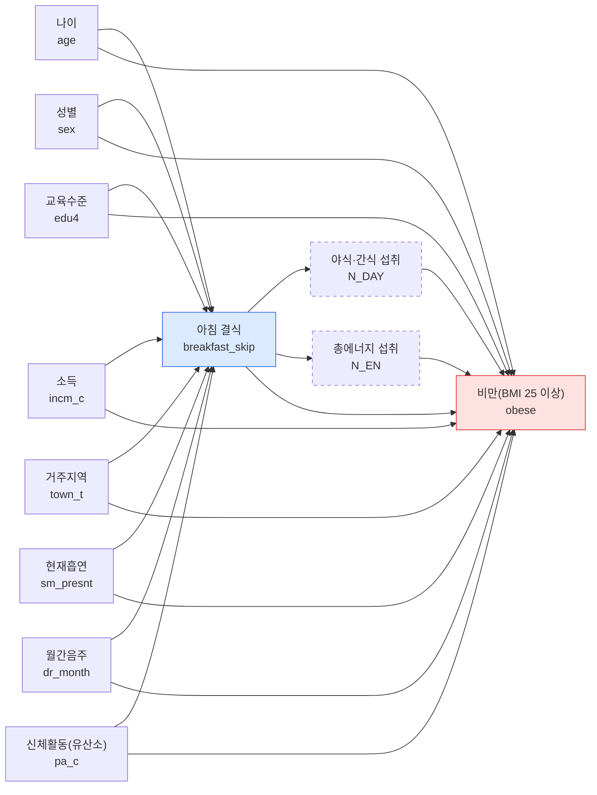

### DAG

점선 테두리는 매개 후보이다. 체중 조절 노력은 비만의 결과일 수 있어(역방향) 정의표에 없는 변수라 그림에 넣지 않고 C-3 한계에 적었다.

### 역할 표

| 변수 | 변수명 | 역할 | 보정 | 근거(시간 순서) |
|:--|:--|:--|:--|:--|
| 나이 | `age` | 교란 | O | 나이는 식습관과 체중보다 먼저 정해진다 |
| 성별 | `sex` | 교란 | O | 성별은 태어날 때 정해지며 식습관과 체중에 모두 영향을 준다 |
| 교육수준 | `edu4` | 교란 | O | 교육은 성인기 식습관과 체중 상태보다 먼저 이루어진다 |
| 소득 | `incm_c` | 교란 | O | 소득은 식사 여건과 식품 선택을 통해 식습관과 체중에 영향을 준다 |
| 거주지역 | `town_t` | 교란 | O | 거주지는 식품 접근성과 생활 환경을 통해 식습관과 체중에 영향을 준다 |
| 현재흡연 | `sm_presnt` | 교란 | O | 흡연은 식욕과 생활 리듬과 관련된다(한 시점 자료라 시간 순서 불확실) |
| 월간음주 | `dr_month` | 교란 | O | 음주는 다음 날 식사와 섭취 열량에 영향을 줄 수 있다(시간 순서 불확실) |
| 신체활동(유산소) | `pa_c` | 교란 | O | 정의표: 식습관과 체중 모두에 영향을 주는 공통 원인으로 간주(애매한 변수, 아래 참고) |
| 야식·간식 섭취 | `N_DAY` | 매개 | X | 아침 결식 후 허기로 야식·간식이 늘고, 이것이 섭취 열량을 통해 체중에 영향을 준다(정의표) |
| 총에너지 섭취 | `N_EN` | 매개 | X | 아침 결식 후 하루 총 섭취 열량이 달라지고, 이것이 체중에 영향을 준다(정의표) |

충돌부로 본 변수는 없다.

### 화살표별 근거

| 화살표 | 근거(시간 순서) |
|:--|:--|
| 나이 → 아침 결식 | 나이는 식습관보다 먼저 정해지며 연령대마다 아침 식사 습관이 다르다 |
| 나이 → 비만 | 나이는 체중 상태보다 먼저 정해지며 연령에 따라 비만 비율이 다르다 |
| 성별 → 아침 결식 | 성별은 태어날 때 정해지며 식사 습관이 성별로 다를 수 있다 |
| 성별 → 비만 | 성별은 태어날 때 정해지며 체지방과 비만 비율이 성별로 다르다 |
| 교육수준 → 아침 결식 | 교육은 성인기 식습관 형성보다 먼저 이루어지며 식사 시간·선택에 영향을 줄 수 있다 |
| 교육수준 → 비만 | 교육은 체중 상태보다 먼저 이루어지며 건강 지식과 생활 습관에 영향을 줄 수 있다 |
| 소득 → 아침 결식 | 소득은 식사에 쓸 시간과 비용 등 식사 여건에 영향을 줄 수 있다 |
| 소득 → 비만 | 소득은 식품 선택과 생활 환경을 통해 체중에 영향을 줄 수 있다 |
| 거주지역 → 아침 결식 | 거주지(동/읍·면)는 식품 접근성과 생활 리듬에 영향을 줄 수 있다 |
| 거주지역 → 비만 | 거주지는 식품·운동 환경을 통해 체중에 영향을 줄 수 있다 |
| 현재흡연 → 아침 결식 | 흡연은 식욕과 생활 리듬에 영향을 줄 수 있다(한 시점 자료라 시간 순서 불확실) |
| 현재흡연 → 비만 | 흡연은 식욕과 대사를 통해 체중에 영향을 줄 수 있다(시간 순서 불확실) |
| 월간음주 → 아침 결식 | 음주는 다음 날 아침 식사에 영향을 줄 수 있다(시간 순서 불확실) |
| 월간음주 → 비만 | 음주는 섭취 열량을 통해 체중에 영향을 줄 수 있다 |
| 신체활동 → 아침 결식 | 신체활동은 식습관과 함께 형성되는 생활 습관이다(정의표: 식습관·체중 모두에 영향을 주는 공통 원인) |
| 신체활동 → 비만 | 신체활동은 에너지 소비를 통해 체중에 영향을 준다 |
| 아침 결식 → 야식·간식 섭취 | 아침 결식 이후 허기로 야식·간식이 늘 수 있다(정의표: 매개 후보) |
| 야식·간식 섭취 → 비만 | 야식·간식은 섭취 열량을 늘려 체중에 영향을 준다 |
| 아침 결식 → 총에너지 섭취 | 아침 결식 이후 하루 총 섭취 열량이 달라질 수 있다(정의표: 매개 후보) |
| 총에너지 섭취 → 비만 | 섭취 열량은 체중에 영향을 준다 |
| 아침 결식 → 비만 | 추정 대상: 아침 결식이 비만에 미치는 총효과 |

### 보정집합

- **추정 대상: 총효과** (아침 결식이 비만에 미치는 전체 효과)
- **최소 보정집합: 나이, 성별, 교육수준, 소득, 거주지역, 현재흡연, 월간음주, 신체활동(유산소)** (교란변수 8개)
- 보정하지 않은 변수: 야식·간식 섭취, 총에너지 섭취(매개). 매개를 보정하면 총효과의 일부를 지우게 된다. 충돌부로 본 변수는 없어 충돌부 보정 문제는 없다.
- 확인: 노트북에서 노출에서 나가는 화살표를 지운 뒤 이 8개로 노출과 결과가 분리되는지(후문 기준) 검사해 모든 후문 경로가 막힘을 확인했다. 또 8개 중 하나라도 빼면 막지 못해 최소 보정집합이다.
- dagitty.net 결과: [dagitty.net에 노트북이 출력한 입력을 붙여 나온 adjustment set을 적는다. 쓰지 않았다면 이 줄을 지운다]
